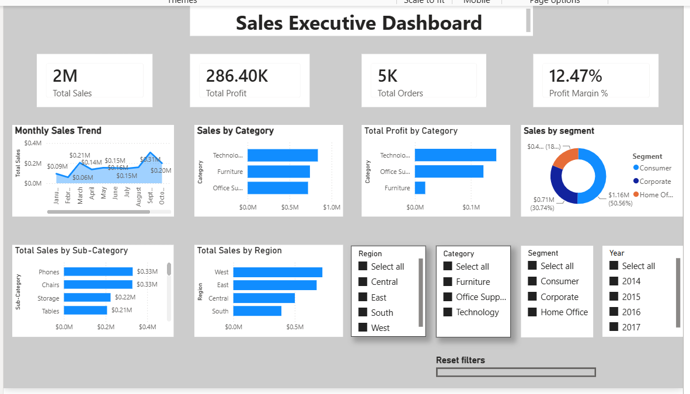
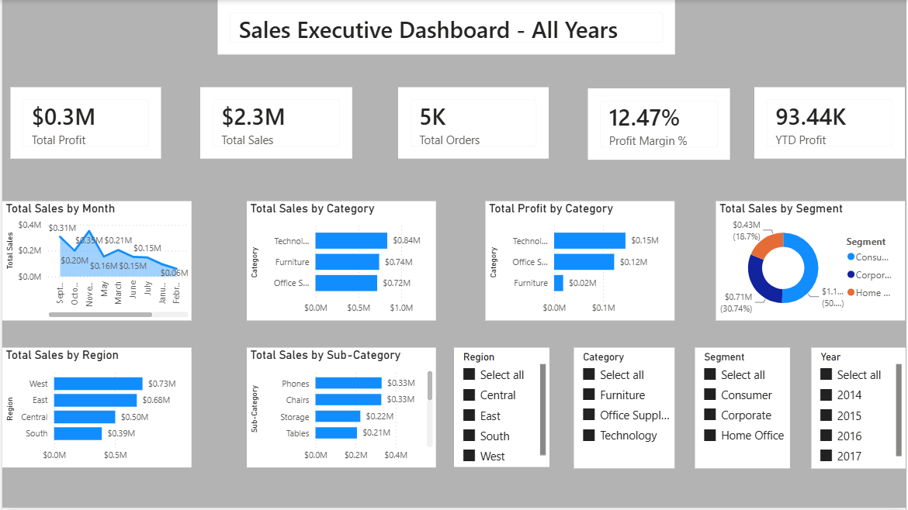
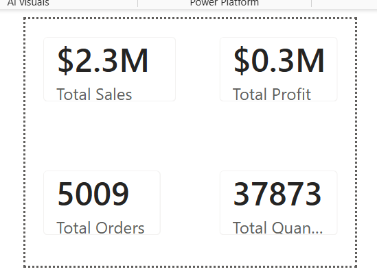
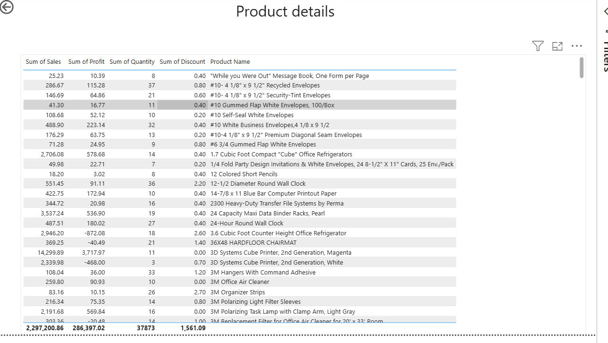

# 📊 Sales Executive Dashboard | Power BI

An interactive Power BI dashboard that gives sales leadership one view of revenue, profit and regional performance, built on the Superstore dataset (9,994 order lines, 2014–2017). Beyond the charts, the analysis shows **where the business makes money and where discounting destroys it.**



---

## 🎯 Business Problem

A sales executive needs to answer, without writing queries:

1. How are sales and profit trending, and when is the peak season?
2. Which regions, categories and sub-categories drive profit, and which lose money?
3. Which customer segments matter most?
4. Where is discounting hurting profitability?

---

## 🔍 Key Insights

| KPI | Value |
|---|---|
| Total Sales | **$2,297,201** |
| Total Profit | **$286,397** |
| Profit Margin | **12.47%** |
| Orders / Units sold | **5,009** / **37,873** |

- **Discounts are the biggest profit leak.** Lines sold with no discount earn a **30%** margin. Discounts of 20–40% turn that into **−15%**, and discounts above 40% into **−77%** (a loss of about **$99.6K**). Discounts above 20% together lose roughly **$135K**, which is nearly half of the total profit earned.
- **Furniture is the weak category.** It brings in **$742K** in sales but only **$18K** profit (a **2%** margin), against **17%** for both Technology and Office Supplies.
- **Three sub-categories lose money:** Tables (**−$17.7K**), Bookcases (**−$3.5K**) and Supplies (**−$1.2K**). Tables is the 4th-largest sub-category by sales ($207K).
- **West leads, Central lags.** West has the most sales (**$725K**, 32% of the total) at a **15%** margin. Central has the lowest margin (**8%**), and Furniture there is loss-making.
- **Some states lose money outright:** Texas (**−$25.7K**), Ohio (**−$17.0K**), Pennsylvania (**−$15.6K**) and Illinois (**−$12.6K**).
- **Sales are seasonal.** September to December generate **52%** of annual sales, with November the peak month ($352K).
- **Growth is strong but recent.** Sales dipped 2.8% in 2015, then grew **+29.5%** in 2016 and **+20.4%** in 2017. Profit margin improved from **10%** (2014) to **13%** (2017).
- **Consumer is the largest segment** at about **51%** of sales, while Home Office has the highest margin (**14%**).

## 💡 Recommendations

- **Cap discounts at 20%.** Review approval rules for deeper discounts, since every band above 20% loses money.
- **Reprice or rethink Tables and Bookcases**, and investigate Furniture pricing and discounting in the Central region.
- **Investigate the loss-making states** (Texas, Ohio, Pennsylvania, Illinois) to see whether discounting or logistics cost is the cause.
- **Plan inventory and campaigns around Sep–Dec**, when over half of sales happen.

---

## 📸 Dashboard Pages

| All Years view | Custom tooltip |
|---|---|
|  |  |

| Product details page |
|---|
|  |

The report has four pages: **Executive dashboard**, **Dynamic dashboard** (all-years view with YTD profit), **Product details** (product-level sales, profit, quantity and discount) and a **Tooltip** page.

---

## 🚀 Features

- KPI cards: Total Sales, Total Profit, Total Orders, Profit Margin %, YTD Profit
- Monthly sales trend
- Sales and profit by category, region, sub-category and customer segment
- Slicers for Region, Category, Segment and Year, with a **Reset filters** bookmark button
- Product details page for product-level drill-down
- Custom tooltip page with sales, profit, orders and quantity

---

## 🧮 Data Model

- **Source:** Sample Superstore dataset (`data/Superstore.xlsx`), 9,994 order lines, 793 customers, orders from Jan 2014 to Dec 2017.
- **Tables:** `Orders` (fact), `People`, a `Date Table`, and a table holding the DAX measures.
- **Measures:** Total Sales, Total Profit, Total Orders, Total Quantity, Profit Margin % (Total Profit ÷ Total Sales) and YTD Profit (time intelligence).

---

## 🛠 Tools

Power BI Desktop · DAX · Power Query · Excel

---

## ▶️ How to Run

1. Clone the repo: `git clone https://github.com/hemanthreddy2105/Sales-Executive-Dashboard-PowerBI.git`
2. Open `Sales_Executive_Dashboard.pbix` in Power BI Desktop.
3. If Power BI asks for the data source, point it to `data/Superstore.xlsx` (Home → Transform data → Data source settings).

---

## 📁 Repository Structure

```
├── data/
│   └── Superstore.xlsx
├── images/
│   ├── 01-executive-dashboard.png
│   ├── 02-all-years.png
│   ├── 03-tooltip.png
│   └── 04-product-details.png
├── Sales_Executive_Dashboard.pbix
├── LICENSE
└── README.md
```

---

## 👨‍💻 Author

**Hemanth Reddy** · Aspiring Data Analyst (Power BI | SQL | Python | Excel)
